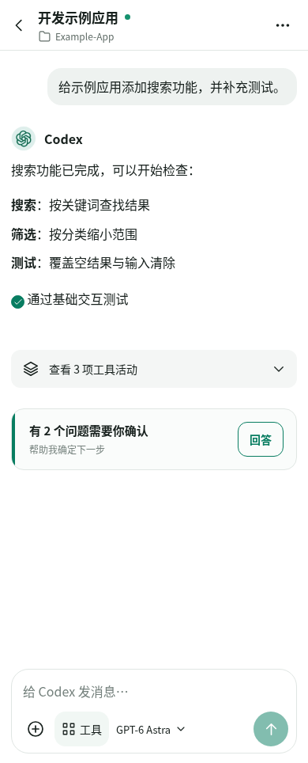
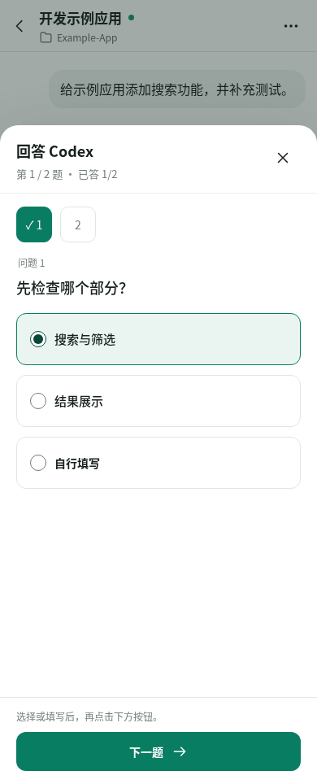
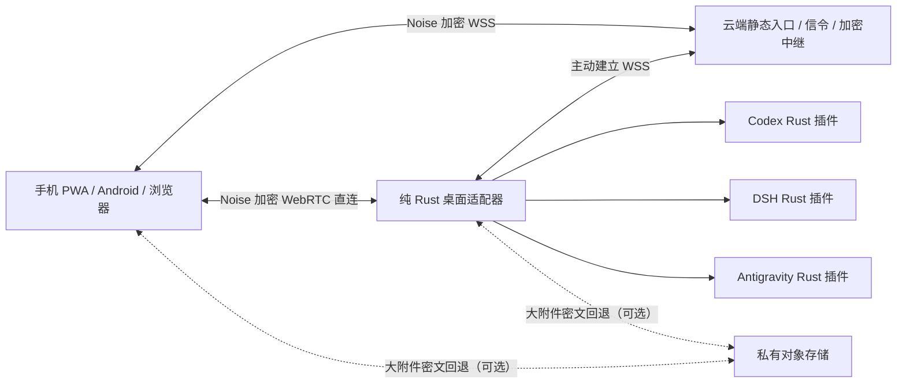

# 子虚亭 · Fable Pavilion


**官方网站：[https://fablepavilion.com](https://fablepavilion.com)** · **网页客户端：[https://app.fablepavilion.com](https://app.fablepavilion.com)** · **安装包下载：[GitHub Releases](https://github.com/muxkin/fable-pavilion/releases)**

**随时随地在手机、平板或网页上，安全接续电脑上的 AI Agent 会话，并与你的 Agent 进行端到端加密聊天和实时通话。**

子虚亭（Fable Pavilion）是一个可自行部署的远程 Agent 工作台与加密消息应用。通过运行在电脑上的**纯 Rust 桌面适配器**和独立插件进程，你可以在移动设备上实时查看本机运行的 **Codex**、**DSH** 与 **Antigravity** 会话进度、继续发送指令、回答提问、处理审批及收发文件；也可以在独立的消息账户中与自己的 Agent 单聊、群聊协作，或发起实时语音和视频通话。

> 本项目为非官方开源项目，仍在快速迭代中。桌面连接依赖各 Agent 客户端的本地接口，不同系统与版本的具体支持范围请见 [使用指南与能力范围](docs/guide/usage.md)。

## 界面预览

| 聊天与工具活动 | 回答问题 |
| --- | --- |
|  |  |

## 核心特性

- **无缝接续桌面 Agent**：按项目浏览和搜索本机 Codex、DSH、Antigravity 会话，实时同步回复与工具活动；手机与电脑共享同一会话，关闭网页不会中断本机任务。
- **完整交互与任务控制**：支持发送、运行中追加、排队下一轮、中断任务、切换模型与计划模式、选择本机技能/插件、逐题回答提问以及处理命令和文件审批。
- **富媒体与附件传输**：支持 Markdown、代码高亮、KaTeX 公式、Mermaid 图表、Diff、图片缩放与音视频播放；支持分块校验与断点续传，优先经由设备级 WebRTC 直连传输，失败时自动回退至加密中继或可选对象存储。
- **人与 Agent 加密消息**：独立的永久字符串 UID 账号体系，支持单聊、群聊、流式回复、交互审批/提问卡片、表情包与语音消息；正文与附件在客户端加密，云端仅保存密文且满 7 天自动清理（头像与表情包永久保留），本地加密缓存不受影响并支持 Markdown / JSON 导出。
- **实时音视频通话**：支持与已接入媒体处理器的 Agent 进行 WebRTC 双向语音与视频通话。
- **纯 Rust 桌面适配器**：无 Node / Python 运行时依赖，系统托盘静默运行，支持 Windows、macOS、Linux 安装包与无头网关，内置离线**秘钥簿**（TOTP 动态码与恢复码本地安全存储）及独立插件在线升级/回滚。
- **统一云端架构与独立管理台**：支持 **VPS / Node** 与 **Cloudflare Workers + Durable Objects + R2** 两种部署方式，共用同一套前端、加密协议与业务逻辑，并配备独立的零知识运维管理台。
- **跨平台客户端、双语与统一主题**：提供 Web / PWA 与 [Android 客户端](android/README.md)（支持核心壳增量验签热更新），全面支持中 / 英双语（跟随系统 / 简体中文 / English），内置行为统一的三套预设主题（月白/夜亭、青竹/墨绿、晴空/深海）、可开关的亭台背景画及 Material Color 自定义主题导入导出。

## 快速开始

- **访问官网了解更多**：[https://fablepavilion.com](https://fablepavilion.com)
- **直接打开网页端**：[https://app.fablepavilion.com](https://app.fablepavilion.com)

### 将网页添加到桌面（PWA 独立应用安装）

子虚亭支持标准 PWA，无需下载商店即可直接安装到手机主屏幕或电脑桌面，获得接近原生应用的独立窗口、全屏沉浸体验与离线缓存：

- **电脑端（Chrome / Edge）**
  1. 使用 Chrome 或 Edge 打开 [https://app.fablepavilion.com](https://app.fablepavilion.com)（或你自部署的站点）。
  2. 点击地址栏最右侧的 **「安装子虚亭」** 图标（或打开浏览器右上角菜单 → **「投放、保存和分享 / 应用 → 安装此站点为应用」**）。
  3. 确认安装后，即可在桌面、开始菜单、任务栏或 macOS 程序坞中作为独立窗口启动。
- **Android 手机 / 平板**
  - **PWA 方式**：在 Chrome / Edge 打开网页后，点击应用内的 **「安装应用」** 提示，或在浏览器菜单选择 **「添加到主屏幕 / 安装应用」**。
  - **原生外壳 APK**：也可在网页端「我的 → 软件下载」或 [GitHub Releases](https://github.com/muxkin/fable-pavilion/releases) 直接下载签名 Android 安装包（支持验签热更新与应用内静默检测升级）。
- **iPhone / iPad（Safari）**
  1. 使用系统自带 **Safari** 浏览器打开 [https://app.fablepavilion.com](https://app.fablepavilion.com)。
  2. 点击底部（或地址栏）的 **「分享」** 按钮（带向上箭头的方框）。
  3. 向下滑动并点击 **「添加到主屏幕」** → 右上角点击 **「添加」**，之后从主屏幕图标打开即可全屏使用。
- **鸿蒙 / 其他移动浏览器**
  - 在浏览器底部或右上角菜单中选择 **「添加到桌面 / 添加到主屏幕」**，即可生成桌面快捷入口。

### 方式一：使用桌面适配器（推荐）

1. 在网页端「我的 → 设置 → 电脑适配器」或 [GitHub Releases](https://github.com/muxkin/fable-pavilion/releases) 下载对应平台的纯 Rust 安装包（Windows / macOS / Linux）。
2. 启动适配器后会在默认浏览器打开本机管理页，点击「登录并授权这台电脑」完成账号授权与加密配对。
3. 使用手机浏览器（PWA）或 Android 客户端登录同一账号，即可在「工作台」访问已授权的电脑会话。

详见 [桌面适配器安装与配置](docs/guide/desktop-adapter.md)。

### 方式二：自行部署云端服务

子虚亭支持两种等价的云端部署方式，可按需选择其一：

- **VPS / Node 部署**（Fastify + SQLite + WebSocket）：见 [VPS 部署指南](docs/deploy/vps.md)
- **Cloudflare 部署**（Workers + Durable Objects + R2）：见 [Cloudflare 部署指南](docs/deploy/cloudflare.md)

完成云端部署后，将桌面适配器的服务地址指向自己的 HTTPS 站点即可使用。

## 连接架构



- 电脑适配器仅主动向外建立 WSS 连接，不监听公网入站端口。
- 手机先通过端到端加密 WSS 建连，后台自动尝试升级为 WebRTC 直连；断网或电脑离线时仍可离线阅读本地缓存。
- 业务流量与附件内容均采用端到端加密，云端中继与对象存储不掌握解密密钥。详见 [账号安全与加密机制](docs/guide/security.md)。

## 文档导航

完整目录见 [docs/README.md](docs/README.md)。

| 类别 | 文档 | 说明 |
| --- | --- | --- |
| **用户指南** | [桌面适配器安装与配置](docs/guide/desktop-adapter.md) | Windows/macOS/Linux 安装、账号授权、秘钥簿、自动更新 |
| | [使用指南与能力范围](docs/guide/usage.md) | 工作台、消息、语音通话、主题、缓存与支持边界 |
| | [账号安全与加密机制](docs/guide/security.md) | 密码与恢复码、动态码、扫码登录、加密模型与信任边界 |
| | [Android 客户端](android/README.md) | Android WebView 外壳使用与签名构建 |
| **自部署运维** | [VPS 部署指南](docs/deploy/vps.md) | Node 24+、反向代理、环境变量、备份与升级 |
| | [Cloudflare 部署指南](docs/deploy/cloudflare.md) | Workers、Durable Objects、R2 与自定义域名 |
| | [对象存储扩展](docs/deploy/storage.md) | 大附件密文回退与原生/Node 存储插件契约 |
| | [推送通知配置](docs/deploy/notifications.md) | Web Push（VAPID）与 Android UnifiedPush 配置 |
| | [可选资源额度（Lago）](docs/deploy/resource-limits.md) | 附件空间与月中转流量策略、客户端解密导出与清理 |
| | [前端发布验签](docs/deploy/frontend-verification.md) | 独立 Pages 签名发布与可选设备核验登录 |
| | [桌面包构建与更新分发](docs/deploy/desktop-distribution.md) | 自建站点的桌面安装包签名发布与云端一致性发行 |
| | [其他部署说明](docs/README.md#自部署与运维) | [一次性加密迁移](docs/deploy/account-migration.md)、[支持项目页面配置](docs/deploy/donations.md) |
| **架构与开发** | [系统架构与通信协议](docs/dev/architecture.md) | 统一核心边界、Noise v2 协议、同步与前端模块 |
| | [适配器插件与开发](docs/dev/adapter-plugins.md) | Rust 原生插件协议、官方插件能力与多实例配置 |
| | [即时消息 API 与 Agent 接入](docs/dev/messaging-api.md) | HTTP API、CLI、流式回复、交互卡片与原生运行器 |
| | [Agent 实时音视频通话](docs/dev/agent-calls.md) | WebRTC 通话协议、Node/原生媒体处理器与 ICE 配置 |
| | [贡献与开发指南](CONTRIBUTING.md) | 本地开发、测试命令、发布检查与 PR 规范 |

## 本地开发

需要 Node.js 24+（构建桌面适配器需要 Rust 工具链）：

```bash
npm ci
npm test
npm run typecheck
npm run build
```

更多测试、构建与提交规范请见 [CONTRIBUTING.md](CONTRIBUTING.md)，版本变更记录见 [CHANGELOG.md](CHANGELOG.md)。

## 许可证

[MIT](LICENSE)
